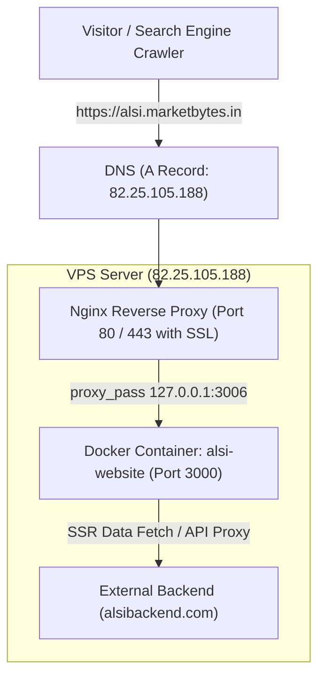

# Production Hosting Guide: ALSI Next.js Website

This guide documents the end-to-end production hosting architecture, configuration, and operational workflow for deploying the **ALSI Next.js Website** on a Linux VPS (Ubuntu) under the subdomain `alsi.marketbytes.in`.

---

## 1. Production Parameters Summary

| Parameter | Production Value | Description |
| :--- | :--- | :--- |
| **Server Public IP** | `82.25.105.188` | VPS Host Server |
| **Subdomain** | `alsi.marketbytes.in` | Public testing & SEO verification domain |
| **Internal Host Port** | `3006` | Host port mapped to container port `3000` |
| **Container Name** | `alsi-website` | Docker service name |
| **Backend API URL** | `https://www.alsibackend.com/api` | External CMS / Data backend |
| **Reverse Proxy** | Nginx (`/etc/nginx/sites-available/alsi`) | Handles SSL, HTTP/2, and proxy pass |
| **SSL Certificate** | Let's Encrypt (Certbot) | Automatic HTTPS on port 443 |

---

## 2. Architecture & Traffic Flow



---

## 3. Step-by-Step Deployment Instructions

### Step 3.1: Connect to VPS via SSH
Open your terminal and connect to the VPS:
```bash
ssh root@82.25.105.188
```

---

### Step 3.2: Clone the Repository
Navigate to `/var/www` (or your preferred directory) and clone the repo:
```bash
cd /var/www
git clone https://github.com/marketbytes-devops/alsinew.git
cd alsinew
```

---

### Step 3.3: Set Up Environment Variables
Create the production `.env` file:
```bash
cp .env.example .env
```
Ensure the values are set:
```env
PORT=3000
NODE_ENV=production
API_BACKEND_URL=https://www.alsibackend.com/api
NEXT_PUBLIC_API_BASE_URL=/api/
NEXT_PUBLIC_RECAPTCHA_SITE_KEY=6Lf_TOQqAAAAAD3PGDryVnbbvXp8MJBL2XtZqKIQ
NEXT_PUBLIC_GTM_ID=GTM-NTVRNF6T
```

---

### Step 3.4: Build & Launch Docker Container
Ensure the deployment script is executable and launch the container:
```bash
chmod +x update.sh
docker compose up -d --build
```

Verify that the container is healthy and responding locally:
```bash
docker ps
curl -I http://127.0.0.1:3006
```
*(You should see `HTTP/1.1 200 OK`)*.

---

### Step 3.5: Configure Nginx Reverse Proxy
Create the Nginx configuration file:
```bash
sudo nano /etc/nginx/sites-available/alsi
```

Paste the following configuration:
```nginx
server {
    server_name alsi.marketbytes.in;

    location / {
        proxy_pass http://127.0.0.1:3006;
        proxy_http_version 1.1;
        proxy_set_header Upgrade $http_upgrade;
        proxy_set_header Connection 'upgrade';
        proxy_set_header Host $host;
        proxy_set_header X-Real-IP $remote_addr;
        proxy_set_header X-Forwarded-For $proxy_add_x_forwarded_for;
        proxy_set_header X-Forwarded-Proto $scheme;
        proxy_cache_bypass $http_upgrade;
        client_max_body_size 50M;
    }
}
```

Enable the configuration and reload Nginx:
```bash
sudo ln -s /etc/nginx/sites-available/alsi /etc/nginx/sites-enabled/
sudo nginx -t
sudo systemctl reload nginx
```

---

### Step 3.6: Install SSL Certificate with Certbot
Run Certbot to automatically provision and configure the Let's Encrypt SSL certificate:
```bash
sudo certbot --nginx -d alsi.marketbytes.in
```
Follow the interactive prompt:
- Enter your email address for renewal notices.
- Agree to the Terms of Service.
- Certbot will automatically redirect HTTP to HTTPS.

---

## 4. Maintenance & Continuous Deployment

Whenever you push new code changes to the `main` branch, update the live site with:
```bash
cd /var/www/alsinew
./update.sh
```

This script automatically:
1. Pulls the latest code from `origin main`.
2. Rebuilds the Docker image using multi-stage build.
3. Restarts the container with minimal downtime.
4. Prunes stale dangling Docker images to preserve server disk space.

---

## 5. Troubleshooting Playbook

| Issue | Likely Cause | Solution |
| :--- | :--- | :--- |
| **Port Conflict (`bind: address already in use`)** | Another service is using port `3006` | Run `sudo lsof -i :3006` or `netstat -tuln \| grep 3006` to inspect, or change port mapping in `docker-compose.yml`. |
| **Image Cache Permission Error (`EACCES`)** | Next.js non-root user cannot write to `.next/cache` | The Dockerfile includes `mkdir -p .next/cache/images && chown -R nextjs:nodejs .next`. Rebuild with `docker compose build --no-cache`. |
| **Nginx `502 Bad Gateway`** | Docker container is stopped or not running on port `3006` | Check container status: `docker logs alsi-website` and `docker ps`. |
| **SSL Issue / Certbot Error** | DNS A record has not propagated yet | Verify with `nslookup alsi.marketbytes.in` before running `certbot`. |
